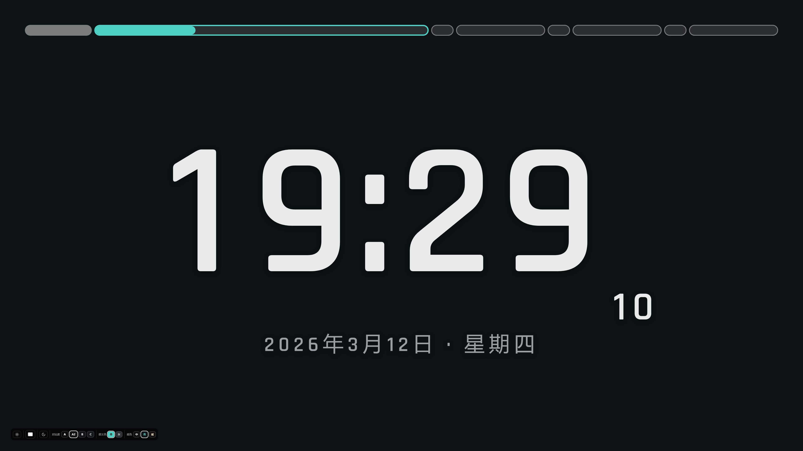
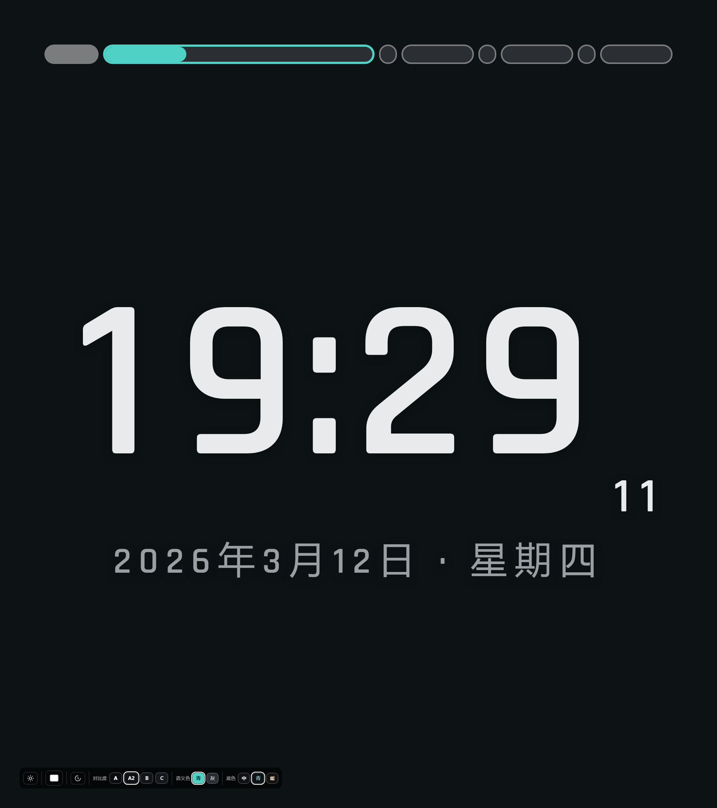

# BigClock · 教室晚自习大屏时钟

给 **3840×2160 教室大屏**用的晚自习时间展示工具。目标只有一个：让学生从教室任何位置一眼看清
**现在几点、现在是什么时段、还剩多久**。

- 顶部分段胶囊进度条按你的作息表驱动，每段宽度 ∝ 真实时长，**当前段语义色高亮**
- **多套作息方案**：上午自习、晚自习各一套，设置里随时切换
- 逐位定宽时钟：换分钟时整块**零位移、零抖动**；字号按容器宽自适应（整屏 / 半屏都不会溢出）
- 基础**暗色（晚自习）+ 亮色（白天开灯）**双主题（4 档对比度、3 种底色偏），外加 **8 个彩色主题**（靛蓝/深海/森林/葡萄/落日/玫瑰 + 宣纸/薄荷）
- **支持整屏 / 左半屏 / 右半屏 / 自定义边界** —— 大屏常有一半边被黑板挡住；半屏不够用时拖两条边界线随便夹
- **浮窗模式**：缩成始终置顶的圆角小时钟，课间放视频/课件时时间仍然可见；可拖动（触屏可用）、可缩放（有最小尺寸）、大小位置会记住
- **时间偏移**：学校挂钟/打铃不准时按秒校准（可正可负）
- 配置就是 exe 旁边一个**纯文本文件**，可以直接拿记事本改，存盘 1 秒内生效，不用重启
- 也可以在程序里按 `F1` 打开设置界面改作息表，**改一个控件就即时写回同一个文本文件**（没有"保存"按钮）

<br>

**整屏（3840×2160）**



**左半屏（1920×2160 竖屏视口）** —— 另一半被黑板挡住时用



---

## ⚠️ 构建时最容易踩的坑（务必先读）

**必须用 `cargo tauri build`，不能用 `cargo build`。**

这两个命令产出的 exe 看起来一样，行为却完全不同：

| 命令 | webview 加载的东西 | 结果 |
|---|---|---|
| `cargo build --release` | **`devUrl`（http://localhost:5183）** | 页面一片空白、什么都不动，而且**完全静默不报错** |
| `cargo tauri build` | `frontendDist`（打进 exe 的 `dist/`） | 正常 |

原因：`cargo build` 走的是 dev 模式，`tauri-build` 会把 `tauri.conf.json` 里的
`devUrl` 编进去而不是 `frontendDist`。开发服务器没开时，WebView2 加载的是
浏览器的"无法连接"错误页 —— 窗口在、标题在、`eval` 也能跑，但你的前端一行都不执行。
排查时极容易误判成"CSP 挡了""资源没打包""字体路径错了"。

（这个坑实际花了很久才定位，详见 `BUG-交接文档.md` 末尾。）

---

## 快速开始

### 只看界面（不需要 Rust，立刻能跑）

```powershell
npm install
npm run dev          # 浏览器打开 http://localhost:5183
```

没有 Tauri 后端时，前端会自动回退到默认配置（一套"晚自习"方案：晚读 + 三节课），
界面、字号自适应、进度条都可以正常看和调。设置面板也能开，只是改动不会写进文件。

### 构建桌面应用（需要 Rust 工具链）

前置条件：

| 依赖 | 说明 |
|---|---|
| Node ≥ 18 | 构建前端 |
| Rust ≥ 1.77 + MSVC 工具链 | `rustup` 装 `stable-x86_64-pc-windows-msvc`，另需 VS2022 生成工具（提供 `link.exe`） |
| WebView2 Runtime | Windows 11 自带；Windows 10 可能需装一次（微软官网免费） |
| Tauri CLI | `cargo install tauri-cli --locked --version "^2"` |

```powershell
npm install
cd src-tauri
cargo tauri build             # ← 注意是 tauri build，它会自己先跑 npm run build
```

### 打包便携版（推荐的分发方式）

```powershell
npm run portable
# 等价于：scripts\build.cmd -Portable（也可以直接双击 build.cmd）
# build.cmd 会挑解释器：有 PowerShell 7（pwsh）用 7，没有才退回 5.1
# 内部走 `tauri build --no-bundle`，再组装目录 + 打 zip + 生成校验和
```

> **`build.ps1` 必须保留 UTF-8 BOM。** Windows PowerShell 5.1 读 `.ps1` 时按
> ANSI/GBK 解码，没有 BOM 就会把中文注释解成乱码、直接语法报错；PowerShell 7
> 默认按 UTF-8 读，无所谓。`build.cmd` 优先用 `pwsh` 就是为了绕开这条，
> 但 5.1 兜底路径仍然依赖 BOM，所以别删。用编辑器改完确认一下前三个字节是
> `EF BB BF`：`Format-Hex scripts\build.ps1 | Select-Object -First 1`。

产物都在 `release\`（已在 `.gitignore` 里，不进仓库）：

| 产物 | 说明 |
|---|---|
| `release\BigClock\BigClock.exe` | 可执行文件 |
| `release\BigClock\bigclock.toml` | 带注释的配置样例（运行后会被设成隐藏） |
| `release\BigClock\README.txt` | 给最终用户看的说明 |
| `release\BigClock_0.1.0_x64_portable.zip` | 整个文件夹压成的包，**分发用这个** |
| `release\SHA256SUMS.txt` | SHA-256 校验和 |

exe 可以直接拷到别的机器上用（那台机器需要 WebView2 运行时）。
首次运行会在 exe 同目录生成 `bigclock.toml`（隐藏属性），不会生成任何日志文件。

### 为什么会被 Windows 拦

程序没有数字签名，从浏览器下载后双击会触发 SmartScreen（"Windows 已保护你的电脑"）。
点 **「更多信息」→「仍要运行」** 即可，之后不再问。

- **用 U 盘拷贝的文件通常没有 Mark-of-the-Web，压根不会弹这个提示** —— 教室多机分发建议用 U 盘。
- 要彻底消除提示只能买代码签名证书（自签名证书没用：它只在手动导入受信任根的机器上有效，在别人电脑上反而显示"签名无效"）。

拿到证书后接进来（`scripts/build.ps1` 里加一步即可）：

```powershell
signtool sign /fd sha256 /tr http://timestamp.digicert.com /td sha256 `
  /f cert.pfx /p <密码> release\BigClock\BigClock.exe
```

---

## 配置

首次启动时，程序会在 **exe 同目录**生成 `bigclock.toml`。它就是个普通文本文件，
用记事本改完存盘，界面 1 秒内自动更新。

这个文件带 Windows 的**隐藏属性**（只改属性位，不动内容和权限）：资源管理器里默认
看不见，勾上「显示隐藏的项目」才看得到。程序里按 `F1` → 「打开所在文件夹」会直接
定位到它。

保存时**就地覆盖同一个文件**（不写临时文件再改名、也不删了重建）：文件标识、创建时间、
隐藏属性、ACL 都不变。之前的写法语义上等于"每次保存都换一个新文件"，资源管理器里它
会跳到排序的另一个位置。

删掉这个文件也没关系：下次启动会重新生成一份带注释的默认配置
（`src-tauri/src/config.rs` 里有一条单元测试守着"默认模板必须能被解析"——
历史 bug 就是模板里把键写了两遍，删掉文件反而起不来）。

参考 [`bigclock.example.toml`](bigclock.example.toml)。

```toml
theme        = "dark"        # dark / light / indigo / ocean / forest / grape / sunset / rose / paper / mint
theme_dark   = "dark"        # 亮暗切换槽：最近用的暗色主题（自动维护）
theme_light  = "light"       # 亮暗切换槽：最近用的亮色主题（自动维护）
mode         = "fullscreen"  # 上一次运行时的形态；启动时 window 强制回全屏，float 保留
half         = "full"        # full（整屏）/ left / right / custom（自定义边界）
screen       = 0             # 第几块显示器，0 = 主屏
contrast     = "A2"          # A | A2 | B | C —— 只对暗色基础主题有效，越往后越柔
tint         = "cyan"        # neutral | cyan | warm（底色偏，只对基础双主题有效）
crop_left    = 0.0           # 自定义边界：左缩进屏宽百分比（half = custom 时生效）
crop_right   = 0.0           # 右缩进；两侧合计 ≤ 70，显示区至少留 30%
float_w      = 0.0           # 浮窗大小（逻辑像素），0 = 默认 640×260
float_h      = 0.0
float_x      = -1            # 浮窗位置（物理像素），-1 = 不指定
float_y      = -1
clock_format = "hm"          # hm（19:29）/ hms（19:29:53）
time_offset  = 0             # 展示时间偏移（秒，可正可负、可超 ±60），挂钟不准时校准
title        = ""            # 顶部标题，留空则不显示

[bar]
enabled     = true           # 是否显示进度条
show_names  = false          # 是否在当前段里显示段名
gap_minutes = true           # 时段之间的空档是否自动补成「课间」

# 多套作息方案：active_plan 指当前生效的方案名
active_plan = "晚自习"

[[plans]]
name = "晚自习"

[[plans.periods]]
name  = "晚读"
start = "18:30"
end   = "19:00"

[[plans.periods]]
name  = "第一节"
start = "19:00"
end   = "19:40"
```

### 时间写法很宽松

`18:40` / `1840` / 全角 `18：40` 都认；`end` 允许写 `24:00`；
**跨零点也支持**：`start = "23:30", end = "00:10"`。

### 进度条规则

每段宽度 ∝ 该段真实时长（长课长胶囊、课间短胶囊），当前段用语义色描边 + 左侧实色填充表示进度。
当前段横向拉长的效果在实测后停用（`src/segments.ts` 的 `GROW_ENABLED = false`，实现保留）。

### 设置界面（即时保存）

按 `F1` 打开设置。**没有「保存 / 放弃修改」按钮**：改一个控件立刻预览，350ms 后自动写回
配置文件（连续打字只写一次）。底部只有「恢复默认配置」——它会丢掉你自己写的作息方案，
所以保留了一个确认框；显示模式 / 半屏 / 浮窗位置不会被重置。

设置面板关掉时**不会再问"还没保存，确定关闭吗"**。如果草稿里有校验不过的内容
（比如两段时间重叠），它不会被写进文件，关面板时界面会恢复成文件里的有效配置。

时间偏移那一栏下面有一行实时读数：「当前显示 23:05:41 · 电脑时间 23:05:33（偏移 +8 秒）」，
拿它跟学校挂钟对一下就知道该填多少，也能直接确认偏移到底有没有生效。

### 健壮性

配置文件写坏（乱码 / 删字段 / 值写错）时，程序**保留上一次有效配置**继续显示，
只在左下角提示错误 —— 绝不让大屏白屏。

---

## 打不开 / 双击后转圈然后没了？

程序**不再静默退出**：启动失败会弹一个系统对话框，写清原因，并把内存里的**启动轨迹**
（最后十几行）一起打在框里 —— 截个图就能定位。

程序**不在 exe 旁边生成任何日志文件**。原因很实际：这是便携程序，会被拷到 U 盘、
别的电脑、只读目录里跑，每启动一次就在旁边多一个 `startup.log` 只是垃圾。
需要留一份档时，设环境变量 `BIGCLOCK_TRACE=<文件路径>` 才会落盘。

排查顺序：

1. 看对话框里的「启动轨迹」最后一行，通常就是原因。
2. 提示「WebView2 的用户数据目录被占用」→ 等十几秒再双击；或任务管理器结束所有
   `msedgewebview2.exe` 后重试。
3. 提示 WebView2 相关错误 → 这台机器缺 WebView2 运行时，去微软官网免费装一次。
4. 日志里反复 `0x800700AA` / `0x8000FFFF`，事件查看器里 `msedgewebview2.exe` 崩在
   `msedge_elf.dll`（异常代码 `0x80000003`、偏移固定），**且双击 / PowerShell / 脚本
   拉起全都一样失败** → 查一下 exe 所在目录是不是被打了低完整性标签（见下方机器坑）。
5. 想主动复现"启动失败"这条路径：设环境变量
   `BIGCLOCK_FORCE_WEBVIEW_ERROR=1`（每次都失败）或 `=first`（只失败第一次，验证重试能救回来）。

> **历史坑（别再踩）**：Tauri 在 setup 阶段创建窗口失败时，是**在事件循环回调里
> `panic!("Failed to setup app: ...")`**，而不是让 `Builder::run()` 返回 `Err`。
> 所以"在 `run()` 外面 match `Err` 然后重试 3 次"是一段**永远走不到的死代码**。
> 现在的做法是 `tauri.conf.json` 里给窗口加 `"create": false`，在 Rust 的 setup 里自己调
> `WebviewWindowBuilder::from_config(..).build()` —— 这条路径**真的会返回 `Err`**，
> 才能重试、才能在彻底失败时弹框。

> **机器坑（2026-10 排查实录，耗时两天）**：**dsh（DeepSeek 编程助手 harness）的
> workspace-write 沙箱**在 Windows 上会给自己工作区的目录打上 **Low 完整性标签
> （含子项继承）**，外加伪造 `S-1-4-*` SID 的授权和 Everyone 防删除 DENY。这是它的
> 官方设计（沙箱进程以 Low 完整性运行，只有 Low 标签目录可写），**但会话结束后
> 残留不清理**（上游已知问题）。
> 后果：树里编出的 exe 继承 Low 标签 → 进程以 Low 完整性级运行 → Edge 沙箱拒绝这种宿主：
> `msedgewebview2` 崩在 `msedge_elf.dll` 固定偏移（0x80000003），宿主侧报 0x800700AA /
> 0x8000FFFF；换哪种启动方式都失败，换 Tauri / WebView2 版本、清 profile、关杀软全都没用
> （SmartScreen、火绒、mojo 通道在这场排查里全被冤枉过）。
> 确诊一条命令：`icacls D:\BigClock | findstr /i "Mandatory Deny"`，看到
> `Low Mandatory Level` 就是它。修复（管理员执行一次）：
> `icacls D:\BigClock /setintegritylevel (OI)(CI)Medium`。
> 子项标签都是继承来的，修根目录即刻全树生效，无需重编 exe。
> **不想记命令就用脚本：双击 [`scripts\fix-integrity-label.cmd`](scripts/fix-integrity-label.cmd)**
> （自动请求管理员权限）——它会先列出当前标签、再修复、最后复检；加 `-CheckOnly` 只查不改。
> **快速判断技巧：同一个 exe 拷到别的目录能跑、原目录不能跑 → 问题在目录的 NTFS
> 元数据，不在代码。**
> **防复发：凡是在 dsh 会话里构建的 exe 都继承 Low 标签，拿去双击必崩。**要么在
> dsh 外重新构建，要么构建后按上面命令把目录恢复 Medium；dsh 升级后可关注该残留
> 问题是否已修复。

---

## 全屏 / 窗口 / 浮窗

**三种形态：** `fullscreen`（全屏展示）/ `window`（带标题栏的配置窗口）/ `float`（置顶浮窗）。

**启动规则**：记成 `window` 时一律强制回全屏（`F11` 退出全屏是"调试时想看眼桌面"的
临时动作，不该被记住）；记成 `float` 时**保留浮窗** —— 浮窗是正式的展示形态
（课间放视频时还要看时间），重启后回到浮窗才是用户要的。强制回全屏只改内存、不写盘，
免得每次开机都重写文件、冲掉注释。

切换入口：

- 左下角控制条上的 **「退出全屏」/「全屏」/「浮窗」按钮**（同一时间只显示当前可用的）
- `F11`（全屏 ⇄ 窗口）、`Esc`（全屏→窗口；浮窗→全屏）

**窗口模式的大小是显式设的**（960×640 逻辑像素，最小 680×440）：不设的话恢复的是
建窗时的 1280×800 逻辑尺寸，在 4K + 高 DPI 缩放下物理尺寸非常大 —— 这就是
"窗口怎么这么大"的历史遗留问题的根源。

## 浮窗模式

把整个程序缩成一个**始终置顶**的圆角小时钟（无边框、背景透明），叠加在视频/课件上面：

- **拖动**：按住卡片拖，鼠标和触屏走同一套手动搬窗逻辑（见下方设计要点），
  按屏幕坐标算位移、按 `devicePixelRatio` 换算物理像素，125% / 150% / 200% 缩放下都跟手
- **点一下卡片** → 弹出一排小圆角按钮（主题 / 显示模式 / 回全屏 / 设置，和全屏控制条一一对应）；
  **再点一下收起**
- **右下角斜纹手柄**：拖动改大小，时间始终自适应占满卡片（不会拉伸数字间距）；
  最小 210×90 逻辑像素，别想拖没了
- 浮窗的大小和位置**自动记住**（写进配置文件），下次进浮窗回到原样
- 浮窗里按 `F1` → 自动切回窗口模式并打开设置

## 自定义边界（half = custom）

整屏 / 左半屏 / 右半屏的补充：显示模式按钮**第四态**。进入后屏幕左右出现两条
**可拖动的竖直边界线**（青色，中间圆手柄带 ↔ 箭头，触屏好按）：

- 拖线调整显示区，最小宽度 30%（别拖得只剩一条缝）
- **3 秒不点它就自动淡出**（边界仍然生效），任意点击再亮回来
- 边界位置记进配置文件（百分比），下次启动还是这样

---

## 快捷键

| 键 | 作用 |
|---|---|
| `F1` | 打开 / 关闭设置（浮窗里按会先回窗口模式） |
| `F11` | 全屏 ⇄ 窗口 |
| `←` / `→` | 左半屏 / 右半屏 |
| `↓` | 整屏 |
| `Esc` | 退出全屏（设置开着时是关闭设置；浮窗时是回全屏） |
| `T` | 亮暗切换（在最近用的亮色、暗色主题之间翻，不丢彩色主题） |

左下角的控制条**始终显示**（浮窗模式除外）：**主题 / 显示模式 / 浮窗 · 设置 · 全屏·退出全屏 + 退出程序**。
显示模式是一个图标四态循环：整屏 → 左半屏 → 右半屏 → 自定义边界，图案跟着变。
两个"退出"（退出全屏 / 退出程序）挨在一起，不会一点就把程序关了。

---

## 设计要点

**半屏 / 自定义边界都不切窗口。** 窗口始终铺满整块显示器（`setFullscreen`），
"左半屏/右半屏"纯粹是 CSS —— `.view` 的 `width:50%` + `translateX`；
"自定义边界"是 `.view` 的 `left` / `width` 跟着两个 CSS 变量（`--crop-l` / `--crop-r`）走，
两条拖动线只是把百分比写进变量。这和 `design-preview.html` 里的做法完全一致。

这么做的好处：不必跟系统的最大化状态、窗口边框、DPI 缩放打架
（切成半个窗口时，`set_size` 设的是内容区、带边框会差一圈；
最大化状态下改尺寸会被系统改回去）。视觉上单显示器和双显示器都等价。

**浮窗复用同一个窗口**，不建第二个窗口：进浮窗 = 把主窗口设成
无边框 + 置顶 + 透明背景（`setBackgroundColor("#00000000")`）+ 指定大小，
页面里 `.view` 换成 `#float` 圆角卡片。缩放是右下角手柄自己接 pointer 事件
（`setMinSize` + JS 双重钳制最小尺寸）。几何（大小/位置）在拖动/缩放结束的
`onMoved` / `onResized` 事件里防抖写进配置文件。

**浮窗拖动为什么是自己搬窗口**：Windows 上 `startDragging`（`WM_NCLBUTTONDOWN` +
`HTCAPTION`）只对鼠标有效，触摸流已经开始之后再发这条消息系统不认 —— 手指按着完全没反应。
所以统一改成手动：`pointerdown` 时就异步取一次 `outerPosition()`（不能等越过 6px 阈值再取，
IPC 一来一回的时间手指已经走了，那段位移会丢），位移用**屏幕坐标 `screenX/Y`**（相对窗口的
`clientX/Y` 会随窗口移动而变，形成反馈回路 → 抖/抽搐），再乘 `devicePixelRatio` 把 CSS 像素
换成物理像素（少了这一步，150% 缩放下手指移 3 格窗口只移 2 格，就是"几乎拖不动"）。
`pointermove` 用 rAF 合并成每帧最多一次 `setPosition`，且不 `await` —— 否则 IPC 队列会堵住，
窗口一跳一跳追手指。指针用 `pointerId` 认，多指/手掌误触不会把状态搞乱。

**彩色主题**是完整的一套配色令牌（背景/前景/语义色/面板……），对比度约束比初版放宽
（前景 ≥ 10:1、语义色 ≥ 3.5:1，实测再低一些也能看清）；暗色系彩色主题同样有时钟暗晕，
`data-lum` 属性统一控制。对比度档位和底色偏仍然只作用于基础双主题。

**字号自适应**量的是真实渲染宽度，再按比例一次乘法解出目标字号 ——
时钟宽度对 `font-size` 严格线性，所以这是精确解，不需要迭代。
浮窗时钟复用同一个 `ClockFitter`（写 `--float-fill`，与主时钟互不干扰），
时间始终占满卡片，**不拉伸数字间距**。
`src/fit.ts` 里记着三条硬规则和一个值得知道的坑。

**被遮挡页面的 rAF 陷阱**（实测踩过）：Chromium 对完全被遮挡的窗口会**暂停
requestAnimationFrame**（`visibilityState` 仍是 visible、`document.hidden` 仍是 false）。
字号自适应和"等布局稳定"都建立在 rAF 上，没有超时兜底的话，窗口被遮挡时整条
启动链会无声卡死。现在 `scheduleFit` 和 `Renderer.settled` 都带 200–250ms 超时兜底。

---

## 目录结构

```
BigClock/
├─ index.html              前端入口（含一段内联自检脚本，见下）
├─ src/
│  ├─ main.ts              启动、控制条、浮窗/边界接线、定时器、设置面板、热重载轮询
│  ├─ float.ts             浮窗：点按弹按钮排、拖动移窗、右下角手柄缩放
│  ├─ crop.ts              自定义边界：两条可拖竖线、3 秒淡出、最小宽度
│  ├─ time.ts              整分对齐时钟
│  ├─ segments.ts          分段计算：宽度分配、三态、拉长规则
│  ├─ render.ts            逐位定宽数字渲染 + 局部 DOM 更新
│  ├─ fit.ts               时钟字号自适应（主时钟 / 浮窗共用）
│  ├─ config.ts            配置类型 + 宽松时间解析 + 兜底校验
│  ├─ styles.css           全部样式（配色令牌、浮窗、边界线、控制条）
│  └─ fonts/               内嵌字体
├─ src-tauri/
│  ├─ src/main.rs          启动、状态管理、主窗口创建与重试
│  ├─ src/config.rs        配置读写 + 宽松解析 + 校验（含浮窗几何/边界钳制）
│  ├─ src/commands.rs      前端可调指令（配置读写 / 打开目录 / 退出）
│  ├─ src/single_instance.rs  命名互斥体
│  ├─ src/startup_trace.rs 启动轨迹 + panic 捕获（只在内存里，不落盘；由弹框带出来）
│  ├─ src/dialog.rs        原生错误框（WebView2 起不来时唯一还能用的提示手段）
│  ├─ src/debug_server.rs  仅测试时开启的只读自省端口（见下）
│  └─ tauri.conf.json
├─ scripts/build.cmd       构建入口（挑 pwsh 7 / 退回 5.1，再交给 build.ps1）
├─ scripts/build.ps1       构建脚本（tauri build --no-bundle + 便携 zip）
├─ release/                便携版产物（.gitignore，不进仓库）
├─ design-preview.html     最早的设计稿（静态 HTML，保留作参考，不参与打包）
├─ BUG-交接文档.md          字号不重算那个 bug 与构建模式坑的完整记录
├─ 实施计划.md              整体方案与验收标准
└─ .preview/               开发期自动化验收脚本（不进仓库）
```

### Rust 侧为什么这么小

只做**前端做不到的事**：读 exe 同目录的配置文件、宽松解析时间、校验、
单实例。窗口形态走 Tauri 官方 JS API，热重载是前端每秒轮询文件原文，
半屏是 CSS。所以三个依赖都省掉了（`windows-sys` / `notify` / `dirs`），
代码量比初版少了一半。

### 排查前端时的自检通道

- `index.html` 顶部有一段内联脚本，把资源加载失败和 JS 异常记进 `window.__selfcheck`
- 设了环境变量 `BIGCLOCK_DEBUG_PORT` 时，程序会开一个**只监听 127.0.0.1 的只读** HTTP 端口：
  - `/state` 当前生效的配置、是否全屏
  - `/why` 让 webview 自述：当前 URL、`window.__selfcheck`、DOM 里有没有渲染出时钟
  - `/raw` 配置文件原文

  不设这个环境变量时这套代码一行都不跑，端口也不存在。

  `/why` 是靠 `eval_with_callback` 实现的 —— 注意 Windows 上 `eval()` 是**不回传返回值**的，
  排查时用 `eval` 拿结果会一直拿到空，这是个很容易踩的坑。

---

## 开发笔记：一个值得记下来的坑

时钟字号在「全屏 ⇄ 半屏」切换后不重算，永远停在 CSS 兜底值 —— 零报错、零控制台输出。
真凶是**一个 NaN**：

```js
parseFloat(getComputedStyle(root).getPropertyValue('--pad-x')) * 2
```

`getComputedStyle` 读**自定义属性**返回的是 **token 流原文**（实测拿到字符串
`"min(5.5vmin, 4.6vw)"`，连 `"2.4vmin"` 都是原样返回），**不是解析后的像素**。
于是 `parseFloat(...)` = `NaN` → `avail = NaN` → `if (!(avail > 0)) return;` **静默返回**。

由此确立三条硬规则（`src/fit.ts` 里也写了）：

1. **绝不用 `getComputedStyle` 读自定义属性再 `parseFloat`** —— 要读就读具体属性
   （`paddingLeft`、`fontSize` 这些返回真实像素）
2. **不要用 em 常量硬算宽度** —— 靠"数格子"推字距个数一定会错
3. **量自然宽度前必须解除约束** —— `max-width:100%` 会把读数夹到容器宽，
   `transform` 会让读数落在位移后的坐标系里

完整记录见 [`BUG-交接文档.md`](BUG-交接文档.md)。

---

## 许可

MIT
